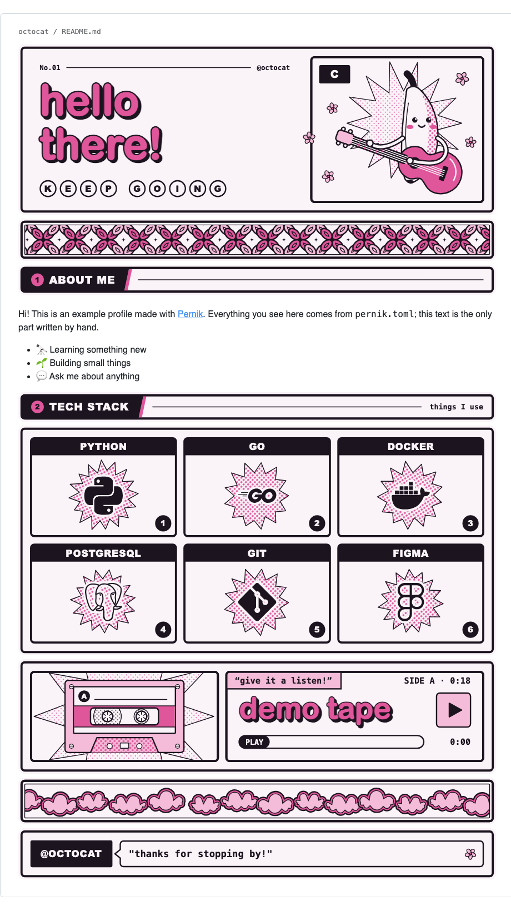

# Pernik

*Pernik* (Indonesian for "small ornaments") is a set of playful widgets for your GitHub profile README: a greeting with a mascot, batik dividers, sticker-style tech logos, section headings, a thank-you ribbon, and a cassette tape that plays your own song.

- **No server.** A GitHub Action (or one command on your computer) turns a `pernik.toml` file into SVG pictures inside your own repo. Nothing can go down, and there are no rate limits.
- **Light and dark.** Every picture is made twice, once for GitHub's light theme and once for dark. The README shows the right one automatically.
- **Yours.** Patterns are generated from your username, so your batik doesn't look like anyone else's. Themes change every colour at once.
- **README-safe.** No scripts and no outside files, just CSS animation. `pernik check` makes sure of it.

**Try it in your browser:** [kocwng.github.io/pernik](https://kocwng.github.io/pernik/) opens the playground, where Pernik runs right in the page. Nothing to install. When you like what you see, **Generate my profile** gives you a zip with a finished README and its pictures: upload it to the repo named after your username and you're done, no Actions needed.

<picture>
  <source media="(prefers-color-scheme: dark)" srcset="docs/example-dark.png" />
  
</picture>

## Quick start

1. In your profile repo (the one named after your username), add `pernik.toml`:

   ```toml
   schema = 1

   [[widget]]
   id = "hello"
   kind = "hero"
   greeting = ["hello", "there!"]

   [[widget]]
   id = "line"
   kind = "divider"
   style = "kawung"
   ```

2. In `README.md`, put a pair of markers where each widget should go. Pernik only touches what sits between them:

   ```markdown
   <!-- pernik:hello -->
   <!-- /pernik:hello -->

   Your own words here.

   <!-- pernik:line -->
   <!-- /pernik:line -->
   ```

3. Add the workflow from [`examples/workflow.yml`](examples/workflow.yml) as `.github/workflows/pernik.yml`. Then go to *Settings → Actions → General → Workflow permissions* and choose **Read and write**.

4. Push. The Action draws the pictures, fills in the markers, and commits.

To try it on your own computer first (Python 3.11 or newer, nothing to install):

```bash
python3 -m pernik init
```

```bash
python3 -m pernik preview
```

Then open `pernik/preview.html` to see every widget on GitHub's light and dark pages.

## Widgets

Run `python3 -m pernik list` for every option.

| Kind | What it draws | Main options |
|---|---|---|
| `hero` | Your greeting in big colourful letters, with a banana playing ukulele | `greeting`, `mascot` (`"banana"` or `"none"`), `chords` (a chords.json to strum along to) |
| `divider` | A section divider: a wavy ribbon or a batik band that draws itself in | `style` (`wave`, `kawung`, `truntum`, `mega-mendung`, `sekar-jagad`, `dots`), `colors`, `height` |
| `heading` | A section title on a coloured sticker pill | `text`, `color`, `align` |
| `stack` | Your tools, each with its logo: comic panels in komik, tilted stickers in stiker | `icons` (names like `"go"`, `"kafka"`, `"Node.js"`), `logos` (your own SVG files), `columns`, `numbered` |
| `footer` | A rainbow ribbon with a thank-you message | `text` |
| `mixtape` | A cassette for your own song, linking to a player page with a live chord card. It can also make a video that plays right on your profile | `song`, `label`, `caption`, `chords`, `make_video`, `video` |

The batik dividers are procedural designs *inspired by* traditional motifs. [docs/motifs.md](docs/motifs.md) explains where each motif comes from.

## Logos in the tech stack

Logos come from [Simple Icons](https://simpleicons.org). You can type a tool's slug, its full name, or one word of it: `"kafka"` finds Apache Kafka and `"Node.js"` finds nodedotjs. If a name matches nothing, the build log suggests close matches.

Some brands aren't in Simple Icons, because their owners asked for them to be removed. AWS and other Amazon logos are one example. Those tools show their name instead of a logo; a short name like AWS is printed whole. To show a real logo, add an SVG file to your repo and point to it:

```toml
[[widget]]
id = "stack"
kind = "stack"
icons = ["go", "kafka", "aws"]
logos = { aws = "assets/aws.svg" }    # or { aws = { file = "assets/aws.svg", color = "#FF9900" } }
```

Only the file's `<path>` shapes are used, drawn in one colour. Make sure you're allowed to use the logo; the brand guidelines usually say how.

## Looks and themes

Pernik has two drawing styles. You pick one by picking a theme.

**komik** (the default): a two-colour risograph comic page. Black ink and one spot colour on soft paper, laid out in manga panels, with halftone dots, a hearts row, an EXP bar and kamboja petals. It follows strict design rules ([docs/design.md](docs/design.md)): four colours, three line weights, an 8-px grid, and three type roles. Every widget is printed on its own paper card, so it looks the same on GitHub light and dark.

| Theme | Spot colour |
|---|---|
| `komik` | magenta |
| `komik-laut` | sea blue |
| `komik-daun` | leaf green |
| `komik-jeruk` | orange |
| `komik-tinta` | ink only, like a photocopy |

**stiker**: bright die-cut stickers with cream outlines on a transparent background. Its themes are `stiker`, `sogan` (batik browns and indigo) and `pastel`.

To make your own theme, change a few values of an existing one:

```toml
# my-theme.toml
extends = "komik"
name = "mine"

[komik]
spot = "#7A4DD8"
tint = "#D9CBF5"
```

Then use it with `theme = "my-theme.toml"`.

## Your own song (mixtape)

```toml
[[widget]]
id = "tape"
kind = "mixtape"
song = "music/my-song.m4a"
```

- **Cassette and player page:** Pernik draws the cassette and writes a player page to `docs/<id>/`. Turn on *Settings → Pages* (branch `main`, folder `/docs`) and clicking the cassette opens the player.
- **Chords:** they're worked out from the song automatically. Edit `docs/tape/chords.json` to fix them, then set `chords = "keep"`.
- **Playing on the profile itself:** GitHub won't play audio in a README, but it will play an uploaded video. Set `make_video = true`, download the MP4 from the Action run, and drag it into GitHub's README editor. Copy the `https://github.com/user-attachments/...` link it gives you into `video = "..."`, and cancel the edit. The README then shows a player strip in place of the cassette.

Only use songs you have the rights to.

## How it works

```
pernik.toml ──► python -m pernik build ──► pernik/<id>-light.svg
                                       ├─► pernik/<id>-dark.svg
                                       └─► README.md (between the markers):
                                            <picture>
                                              <source media="(prefers-color-scheme: dark)" srcset="pernik/<id>-dark.svg">
                                              -light.svg">
                                            </picture>
```

Widgets are small Python functions. See [CONTRIBUTING.md](CONTRIBUTING.md) to add a widget, a theme, or a mascot.

## Commands

| Command | What it does |
|---|---|
| `python3 -m pernik build [pernik.toml]` | Draw everything and fill the README |
| `python3 -m pernik preview` | Build, then write `pernik/preview.html` |
| `python3 -m pernik check` | Build, then check every file is safe and small enough for GitHub |
| `python3 -m pernik list` | Every widget and its options |
| `python3 -m pernik init` | A starter `pernik.toml`, `README.md` and workflow |

**Playground:** to run the browser playground on your own computer, build the site and serve it:

```bash
python3 tools/build_site.py && python3 -m http.server -d site 8000
```

Then open http://localhost:8000.

## License

The code is MIT. The mascot art is CC BY 4.0. Logos come from [Simple Icons](https://simpleicons.org) (CC0); the brands remain trademarks of their owners. See [LICENSE](LICENSE).
