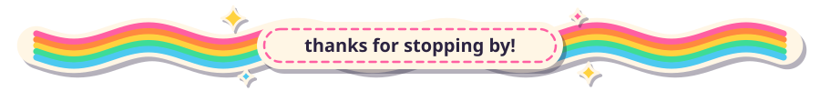

<!-- pernik:hello -->
<picture>
  <source media="(prefers-color-scheme: dark)" srcset="./pernik/hello-dark.svg" />
  
</picture>
<!-- /pernik:hello -->

<!-- pernik:line-kawung -->
<picture>
  <source media="(prefers-color-scheme: dark)" srcset="./pernik/line-kawung-dark.svg" />
  
</picture>
<!-- /pernik:line-kawung -->

<!-- pernik:about-title -->
<picture>
  <source media="(prefers-color-scheme: dark)" srcset="./pernik/about-title-dark.svg" />
  
</picture>
<!-- /pernik:about-title -->

Hi! This is an example profile made with [Pernik](../../README.md). Everything you see
here comes from `pernik.toml`; this text is the only part written by hand.

- 🔭 Learning something new
- 🌱 Building small things
- 💬 Ask me about anything

<!-- pernik:line-wave -->
<picture>
  <source media="(prefers-color-scheme: dark)" srcset="./pernik/line-wave-dark.svg" />
  
</picture>
<!-- /pernik:line-wave -->

<!-- pernik:stack-title -->
<picture>
  <source media="(prefers-color-scheme: dark)" srcset="./pernik/stack-title-dark.svg" />
  
</picture>
<!-- /pernik:stack-title -->

<!-- pernik:stack -->
<picture>
  <source media="(prefers-color-scheme: dark)" srcset="./pernik/stack-dark.svg" />
  
</picture>
<!-- /pernik:stack -->

<!-- pernik:line-truntum -->
<picture>
  <source media="(prefers-color-scheme: dark)" srcset="./pernik/line-truntum-dark.svg" />
  
</picture>
<!-- /pernik:line-truntum -->

<!-- pernik:tape -->

<!-- /pernik:tape -->

<!-- pernik:line-mega -->
<picture>
  <source media="(prefers-color-scheme: dark)" srcset="./pernik/line-mega-dark.svg" />
  
</picture>
<!-- /pernik:line-mega -->

<!-- pernik:bye -->
<picture>
  <source media="(prefers-color-scheme: dark)" srcset="./pernik/bye-dark.svg" />
  
</picture>
<!-- /pernik:bye -->
