<!-- pernik:hello -->

<!-- /pernik:hello -->

<!-- pernik:line-kawung -->

<!-- /pernik:line-kawung -->

<!-- pernik:about-title -->

<!-- /pernik:about-title -->

Hi! This is an example profile made with [Pernik](../../README.md). Everything you see
here comes from `pernik.toml`; this text is the only part written by hand.

- 🔭 Learning something new
- 🌱 Building small things
- 💬 Ask me about anything

<!-- pernik:stack-title -->

<!-- /pernik:stack-title -->

<!-- pernik:stack -->

<!-- /pernik:stack -->

<!-- pernik:tape -->

<!-- /pernik:tape -->

<!-- pernik:line-mega -->

<!-- /pernik:line-mega -->

<!-- pernik:bye -->

<!-- /pernik:bye -->
